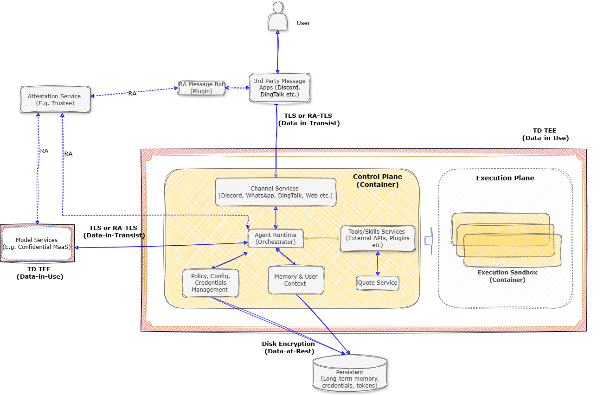
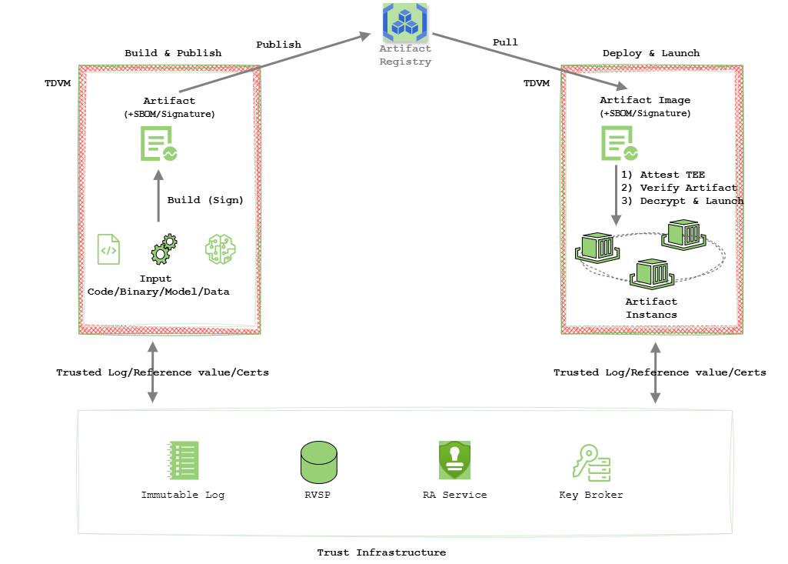

<div align="right">
  <a href="./README_CN.md">中文版</a>
</div>

# Agentic AI System in Confidential Computing (Agent-CC)

## Overview

Agent-CC is a deployment architecture and reference implementation for running agentic AI workloads on platforms that support Intel TDX (Trust Domain Extensions). It introduces confidential computing through deployment-side plugins or service sidecars, requiring only minor configuration changes to agent frameworks and dependent services. It works alongside existing sandboxing, policy enforcement, supply-chain controls, and service authorization, using hardware-rooted trust to provide isolation, verifiable runtime evidence, and attestation-based access control for stronger security in confidential agent deployments.

Agent-CC provides three core capabilities:
- **Lifecycle Data Protection** (hardware memory encryption, attestation-gated access to encrypted storage, and immutable audit logs)
- **Build-to-Runtime Integrity** (connecting supply-chain verification to runtime measurements through TC API)
- **Trusted Service Composition** (mutual attestation and trust verification before sensitive data is exchanged with external services).

## Agentic AI Architecture & Security Threats

### Agent System Architecture

AI agents operate across three functional domains:

- **Control Plane**: Gateway, orchestration, context & memory management, policy & secrets management
- **Execution Plane**: Code interpretation and tool execution (the zone requiring strongest isolation)
- **External Services**: LLM APIs, knowledge bases, tool services, and persistent stores


### Security Threats & TEE Mitigation

Recent OWASP references ([Agentic AI - Threats and Mitigations](https://genai.owasp.org/resource/agentic-ai-threats-and-mitigations/) and [OWASP Top 10 for Agentic Applications 2026](https://genai.owasp.org/resource/owasp-top-10-for-agentic-applications-for-2026/)) and EU compliance analysis ([AI AGENTS UNDER EU LAW: A COMPLIANCE ARCHITECTURE FOR AI PROVIDERS](https://arxiv.org/pdf/2604.04604)) together highlight both security exposure and governance expectations for agent systems.

For deployment analysis, we summarize these concerns into six operational categories:

1. **Cognitive & Decision Integrity**: resistance to context poisoning, goal manipulation, and reasoning failure
2. **Runtime Compromise**: prevention of unsafe execution paths, tool misuse, and runtime breakout
3. **Secret & Memory Exposure**: protection against prompt, credential, and context leakage
4. **Identity & Access Trust**: strong authentication, authorization, and auditable identity binding
5. **System & Supply Chain Integrity**: build-to-runtime integrity for models, tools, dependencies, and images
6. **Untrusted Service Interaction**: secure agent-to-agent and agent-to-service communication

Category 1 is primarily AI-native. Categories 2 to 6 are deployment-facing and map directly to runtime trust architecture. In this scope, Confidential Computing, especially Intel TDX, serves as an enabling layer that strengthens containment, confidentiality, attestation, integrity, and trusted service interaction.

In practice, TD (Trust Domain) deployment provides a stronger trust foundation when combined with sandboxing, policy enforcement, signed artifacts, encryption at rest, and TLS.

| Security concern | What TD helps do directly | What it should be combined with |
| --- | --- | --- |
| Runtime Compromise | Reduces host-side exposure and strengthens isolation for control-plane and task execution | Task sandboxing, least privilege, policy enforcement, syscall filtering |
| Secret & Memory Exposure | Protects in-use memory from host, hypervisor, and operator-level inspection | Secret scoping, short-lived credentials, output filtering, data minimization |
| Identity & Access Trust | Provides hardware-backed runtime identity evidence and stronger attestation-based trust establishment | Strong authentication, IAM policy, identity binding, verifier infrastructure, key-release policy |
| System & Supply Chain Integrity | Extends trust from signed artifacts to measured boot and launch | Image signing, SBOMs, dependency governance, reproducible builds, CI/CD admission |
| Untrusted Service Interaction | Enables attested channels that verify peer identity and runtime state | TLS, service authorization, trust policy, secure session setup, key management |


## Three Core Capabilities

### Lifecycle Data Protection

TD is the trust foundation for lifecycle data protection. Agent processes run inside a hardware-isolated TD where memory is encrypted by default, runtime identity and launch measurements are verified through attestation, and secrets are released only to attested environments. The same trust boundary extends to persisted data: encrypted state is decrypted only inside verified TD runtimes.

This model protects three critical data surfaces:

- **Runtime Context and Memory (Data in use)**: Active context, intermediate reasoning state, and tool outputs remain in encrypted TD memory, reducing exposure from host- or hypervisor-level observation.
- **Secrets and Permissions (Data in use)**: API keys, tokens, and credentials are provisioned through attestation-gated release, shifting the model from post-release protection to trust-before-release.
- **Long-Term Memory and Persisted Data (Data at rest)**: Stored data remains encrypted across persistence boundaries and is released only to approved runtimes that pass attestation checks.

Together, these controls provide a coherent protection path: sensitive data is encrypted by default, decrypted only inside verified TD boundaries, and shared only after trust verification succeeds.



<div align="center">Figure 1: Full data lifecycle protection - OpenClaw as example</div>

### Build-to-Runtime Integrity

In agent systems, build-time intent and deployment policy are not sufficient on their own: the system must prove what is actually running, detect runtime deviation from approved software and policy, and provide verifiable execution claims to verifiers and peer services. Through **TC API**, Agent-CC connects supply chain evidence to attested runtime state so trust decisions are enforced in execution, not only in design.


- **End-to-end trust chain**: Connects build artifacts to attested runtime execution, ensuring workloads are verified before execution.
- **Trusted build**: Produces signed artifacts with SBOM and immutable provenance for supply chain integrity.
- **Pre-execution verification**: Enforces signature and SBOM checks, then binds workload identity to attested hardware TCB evidence.
- **Trusted launch**: Runs workloads inside isolated TDVM environments with hardware-backed guarantees.
- **Attestation-driven execution**: Governs runtime execution and secret provisioning with attestation-based trust decisions.



<div align="center">Figure 2: From Build Artifacts to Attested Runtime</div>

### Trusted Service Composition

Trusted service composition extends trust from the agent's local runtime to external services such as models, retrieval, and memory services. As the agent interacts with these services, it verifies their identity, remote attestation, and policies, while secure channels such as TLS protect data in transit and keep the end-to-end processing path within a verifiable trust boundary.

The identity verification system supports Non-SPIFFE and SPIFFE strategies. In the Non-SPIFFE strategy, services are launched through TC API, and the Evidence Engine binds TEE information and custom service-instance identity information to the interaction flow; the Trust Guard on the agent side then authenticates the service identity. In the SPIFFE strategy, TEE information is bound to the service instance's SPIFFE identity and then authenticated through Trust Guard.

## Quick Start

For a complete OpenClaw + OpenViking attestation flow, follow the [OpenClaw adapter guide](./adapters/OpenClaw/README.md). It covers the TDX and Docker prerequisites, TC-API credentials, and the end-to-end startup steps.

From the repository root, after meeting those prerequisites:

```bash
cd cczoo/agent-cc/adapters/OpenClaw/scripts
read -rsp 'TC-API identity token: ' TC_API_IDENTITY_TOKEN
printf '\n'
export TC_API_IDENTITY_TOKEN
./run_openclaw_openviking_e2e.sh
```

The script starts the required services, launches the workload through TC-API, and runs the attestation-backed example. Keep the token out of source files and logs.

## Project Status

Status: ✅ Completed　🚧 In progress

**Best Practices & Guides**

- 📘 **[OpenClaw Confidential Agent Best Practices](./best-practices/README.md)**: End-to-end OpenClaw reference for local LLM co-location, encrypted state, and runtime attestation.

**Core Services**

[Core Services](core/README.md) implement the three architecture requirements described above:

- ✅ **[TC API](core/tc_api)**: Trusted build/publish/launch control path for build-to-runtime verification and policy enforcement.
- ✅ **[Trusted Log (TLog)](core/tlog)**: Immutable, signed runtime evidence and audit trail.
- 🚧 **Argus (Trusted Service Composition)**: Architecture for cross-service trusted admission and interaction.

**Adapters × Deployment Mode**

Status applies to each combination: ✅ implementation or example available; 🚧 in progress or awaiting validation; — not applicable/not currently provided.

| Adapter/capability | Single TD | Container execution within a single TD | Task-partitioned TDs (CoCo/Kata or TD + cc-sandbox) |
| --- | --- | --- | --- |
| [Ollama LLM service](./adapters/Ollama/README.md) | ✅ | 🚧 | 🚧 |
| [OpenClaw](./adapters/OpenClaw/README.md) | ✅ | ✅ | — |
| [Hermes Agent](./adapters/Hermes/README.md) | ✅ | 🚧 | 🚧 |
| Third-party service communication | 🚧 | 🚧 | 🚧 |
