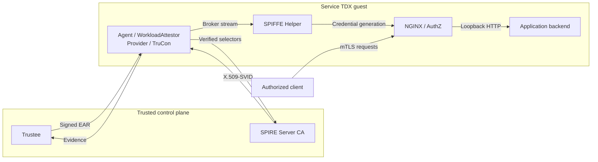

# TDX identities for SPIRE

Argus integrates TDX attestation with SPIRE through external plugins.
Node attestation authenticates the SPIRE Agent. Workload attestation checks
a registered workload instance before SPIRE Server issues its separate
X.509-SVID. SPIFFE Helper binds NGINX's use of that identity to the registered
backend, providing an authenticated NGINX endpoint for service requests.

| Stage | Decision and output |
|---|---|
| Node attestation | Authenticate the Agent against its approved identity, proof key and TDX policy; SPIRE Server CA issues the Agent SVID |
| Workload attestation | Check the registered process and authenticated lifecycle history; match verified selectors to the workload entry before SVID issuance |
| Identity delivery | Publish the workload credentials and confirm NGINX readiness for the registered backend |
| Service access | Authenticate both TLS peers, authorize the exact client SPIFFE ID, and retain the application's own authorization |

The overview groups evidence collection and attestation components. The
[workload sequence](workload/ARCHITECTURE.md) separates their responsibilities.
The business container receives neither SVID private keys nor management sockets;
NGINX is managed by trusted components inside the TDX guest and forwards to
the backend's loopback listener in the target network namespace.

| Component | Purpose |
|---|---|
| `plugins/argus-tdx-nodeattestor` | Agent-slot proof of possession and Trustee appraisal for node admission |
| [WorkloadAttestor](plugins/argus-tdx-workloadattestor/README.md) | Verify evidence for Broker `WorkloadPIDReference` requests and return verified workload selectors |
| [Workload deployment](workload/README.md) | PID-instance registration, policy, NGINX configuration and systemd lifecycle |
| [SPIFFE Helper](helpers/spiffe-helper/README.md) | Broker subscription, target supervision and credential delivery to guest-managed NGINX |
| [Trustee integration](workload/trustee/README.md) | Verification of the immutable TruCon history against authenticated RTMR2 |

OpenViking is the supplied application example. Configuration-path environment
bindings, startup environment and optional JSON checks are declared in the
protected deployment input; the common code does not recognize OpenViking keys.

The deployment uses SPIRE **1.15.3**, Trustee **0.21.0** and the Helper build
provided here. It requires Linux x86_64 with real TDX/TSM support
and SPIRE's experimental Broker API. SPIRE Core is used without a source patch.

Start with the [deployment guide](workload/README.md) and
[trust boundaries](workload/ARCHITECTURE.md). Node configuration is documented
in the [Argus configuration reference](../argus/docs/configuration.md#spire-node-attestation).
