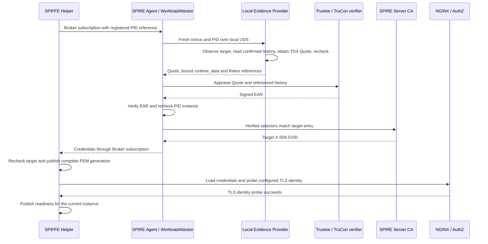

# Workload attestation and service access

The deployment attests one registered application process and connects its
SPIFFE identity to the NGINX service endpoint. An instance is identified by its
guest boot, controlled launch, container, PID and process start time. Its logical
SPIFFE ID may remain the same across legitimate replacements; each replacement
requires its own registration and admission.

The SPIRE Agent, Evidence Provider, Helper, TruCon, Docker and guest-managed
NGINX run inside the TDX guest. Trustee appraises evidence and signs the EAT
Attestation Result (EAR); SPIRE Server's CA issues X.509-SVIDs. The business
container receives neither a management socket nor an SVID private key.

## Admission and identity delivery

The sequence begins after node admission and controlled application launch.
The backend must already be listening before its actual process can be
registered and inspected. Admission, identity availability and ingress
readiness are separate steps.

## Evidence and authority

Registration records the container's full ID, launch ID, PID/start time,
guest boot ID, namespaces, executable, actual image config ID, configuration
digest, configuration environment binding and listener. The configured
environment variable must name the registered path in the actual process;
Provider also checks Docker's environment declaration. Provider independently
observes the process and checks the target and confirmed history before and
after Quote generation. Runtime data is encoded as canonical JSON, hashed
with SHA-384 and bound into the TDX Quote's `REPORTDATA` field.

Registration records target facts; approved configuration and policy supply
the admission criteria. The executable field is a path, not a file-content
hash. The image config ID identifies Docker's image configuration and is
distinct from a registry manifest digest. Application environment names and
optional JSON configuration checks come from the protected deployment input;
public attestation code does not identify a product by its configuration keys.
An environment path declaration does not prove application consumption of
the file. Approval of the image, configuration and startup mapping remains
the operator's responsibility.

TruCon's root-only UDS returns a complete ordered history, bounded to 4096
entries. Unconfirmed history or an unresolved Docker mutation denies the
snapshot. Docktap reserves a durable fence before forwarding a mutation,
saves a known response, and releases the fence only after immutable-log
confirmation. An uncertain Docker outcome remains pending; recovery does not
replay the Docker request or expire that fence. This history gate blocks new
admission; an existing ingress remains governed by local instance supervision.

Trustee first authenticates the TDX Quote and its binding. Its server-local
verifier then fetches the configured Rekor entries, verifies signatures,
certificate trust, inclusion evidence and chain links, replays RTMR2 from an
approved baseline, and associates the current launch with the observed
container. Admission requires exactly one matching successful measured launch
and no later successful `stop`/`rm` for that container. Permitted unrelated
events can extend the history without invalidating the target launch. Rego
consumes server-owned `trucon` claims. WorkloadAttestor verifies the signed
EAR and its target binding; SPIRE Server's CA signs the resulting SVID.

The following values describe the current protocol and implementation. They
are field sizes, limits and timeouts, rather than measured performance.

| Parameter | Value | Source |
|---|---|---|
| Workload challenge | 32 random bytes, unpadded base64url | [WorkloadAttestor](../plugins/argus-tdx-workloadattestor/internal/workloadattestor/plugin.go) |
| TDX `REPORTDATA` | 64 bytes: 48-byte SHA-384 digest plus 16 zero bytes | [Shared protocol](protocol/protocol.go) |
| Complete history references | 2–4096 distinct entries | [Shared protocol](protocol/protocol.go) |
| Target entry selectors | All 6 verified values required | [Plugin reference](../plugins/argus-tdx-workloadattestor/README.md#registration-selectors) |
| Trustee history verifier | At most 4 concurrent subprocesses; 50-second budget including slot wait | [Trustee hook](trustee/argus_trucon.rs) |
| Plugin HTTP request timeout | Default 55 seconds; allowed range `(50s, 60s]` per request | [Plugin configuration](../plugins/argus-tdx-workloadattestor/internal/workloadattestor/config.go) |

## Identity delivery and lifetime

Helper uses its own infrastructure SVID to connect to the Agent Broker and
requests the registered target's identity. Complete PEM generations are
published atomically in root-owned tmpfs. The NGINX hook checks configuration
and the loaded certificate before Helper publishes readiness for its current systemd
invocation and target.

NGINX runs in the business container's network namespace, exposes the TLS
listener, and proxies to the application's loopback listener. TLS certificate
validation is followed by an exact URI SAN allowlist check through local
AuthZ. The application's own authorization rules still apply; OpenViking's
API-key header is one explicitly configured example.

| Lifecycle event | Remote workload appraisal | Identity and ingress handling |
|---|---|---|
| SVID update on the same valid Broker subscription | Reuse admission; no new workload Quote | Publish the new generation and reconfirm readiness after target checks |
| New subscription for the same instance | Collect fresh evidence and re-evaluate history | The original launch remains usable only while it satisfies policy |
| Replacement instance | Register and admit the replacement independently | Bind credentials and ingress to the new PID/start/boot/container/launch |
| Observed target, credential or supervision failure | The failure path does not grant new admission | Withdraw readiness, clean up credentials and initiate NGINX shutdown |

The systemd watchdog covers a stopped or stuck Helper. Detection and ingress
shutdown are asynchronous; configured watchdog or stop timeouts do not
establish a total detection-to-closure bound. Removing PEM files does not
revoke copies of issued SVIDs; certificate expiry and issuer trust still apply.

## Trust and scope

The guest kernel/root, Docker, recording path, registration and collection,
SPIRE Agent, Helper, NGINX/AuthZ and their protected configuration form the
trusted guest management domain. The application cannot modify that domain
or access the Docker/management sockets. Trustee, SPIRE Server and its CA,
policy administration and trust material are also trusted. A client must
authenticate the target SPIFFE ID and protect its own identity material.

Admission and local monitoring do not establish continuous application-memory
integrity or application correctness. Ordinary service requests use the
established ingress without a fresh remote attestation per request. History
verification authenticates the submitted chain against the current Quote;
it does not by itself provide storage rollback protection or global log-fork
prevention.

See the [deployment guide](README.md) for configuration and operations.
